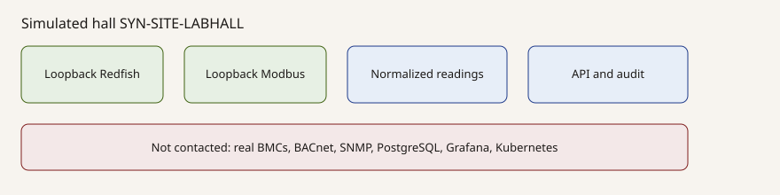
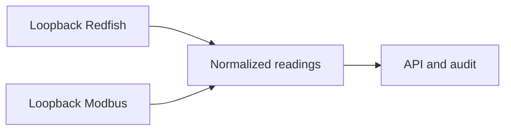

# Simulated data-center telemetry

Independent loopback lab for racks, a Redfish server, a Modbus PDU, cooling, and a sensor. It is not a Supermicro product and it is not a customer site. Notice `SIMULATED_DATACENTER_NOT_A_CUSTOMER_SITE`. Deployment decision: **NO-GO**.





## What is measured

One in-process pass over 100 devices, transport `in-process-documents`, `tcp_sessions` 0. The configured interval is 5 seconds and it was not slept. Stored readings 340. Errors 0. Drops 0. Error rate 0.0. Elapsed seconds 0.0010139000078197569. Throughput 335338.788221454 readings per second. That throughput is document normalization on this CPU. It is not a Modbus or Redfish network rate.

Per-device seconds: min 3.5999983083456755e-06, p50 7.800001185387373e-06, p95 1.0100018698722124e-05, max 3.580001066438854e-05, calls 100.

Hardware from the CIM query in that run: 11th Gen Intel(R) Core(TM) i7-1185G7 @ 3.00GHz, 4 cores, 8 logical processors, Python 3.12.10, Windows. Free physical memory was 7343608 KB of 32916868 KB.

Local pytest: 11 passed, coverage 94.54%. Ruff was clean. Mypy was clean on 15 source files. `go test ./...` in `services/go-collector` passed. The C++ agent printed `SYN-SENS-CPP-0001` with `hardware` `not-contacted`. Price is none.

The table is `benchmarks/latest.json`. Loopback Redfish and Modbus are covered by pytest, not by this 100-device pass.

## Quick start

```powershell
python -m venv .venv
.\.venv\Scripts\python.exe -m pip install -e ".[dev]"
.\.venv\Scripts\python.exe -m pytest
.\.venv\Scripts\python.exe scripts\run_benchmark.py
.\.venv\Scripts\python.exe -m dc_telemetry gates
```

`gates` prints the not-run table and does not open a socket. Pytest starts loopback listeners. The benchmark does not.

## Checklist

- [x] Simulated devices are listed by the API
- [x] Redfish and Modbus return normalized readings on loopback
- [x] A simulated sensor fault raises one alert
- [x] History is queryable from the in-memory store
- [x] An observer command is rejected
- [x] Timeout and reconnect are tested
- [ ] Docker Compose was not started on this workstation
- [x] Architecture, protocols, and the runbook are in `docs/`

PostgreSQL, Grafana, a Prometheus server, BACnet, SNMP, Kubernetes, and real equipment were not run. The Go collector and the C++ agent are separate programs. Their results belong in the measurement section only after they are run.

## License

MIT. Copyright 2026 Jatinder Singh.

This repository was written in a Grok Build session. See [docs/ai-sdlc.md](docs/ai-sdlc.md).
